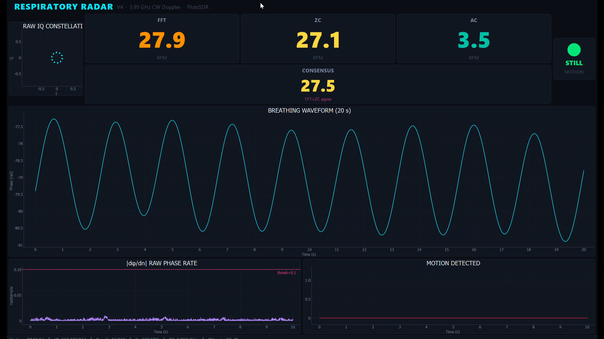
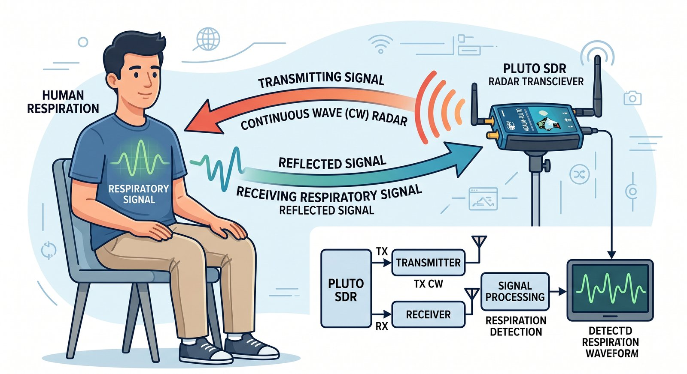
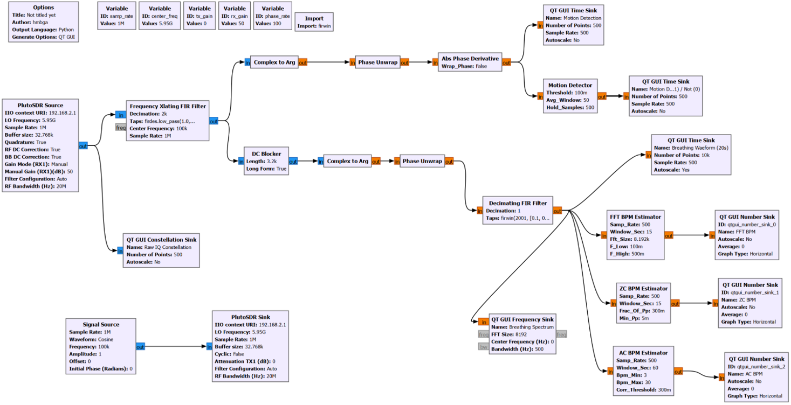
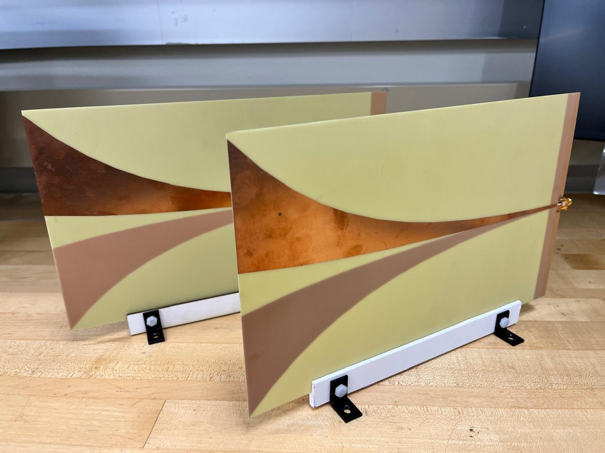
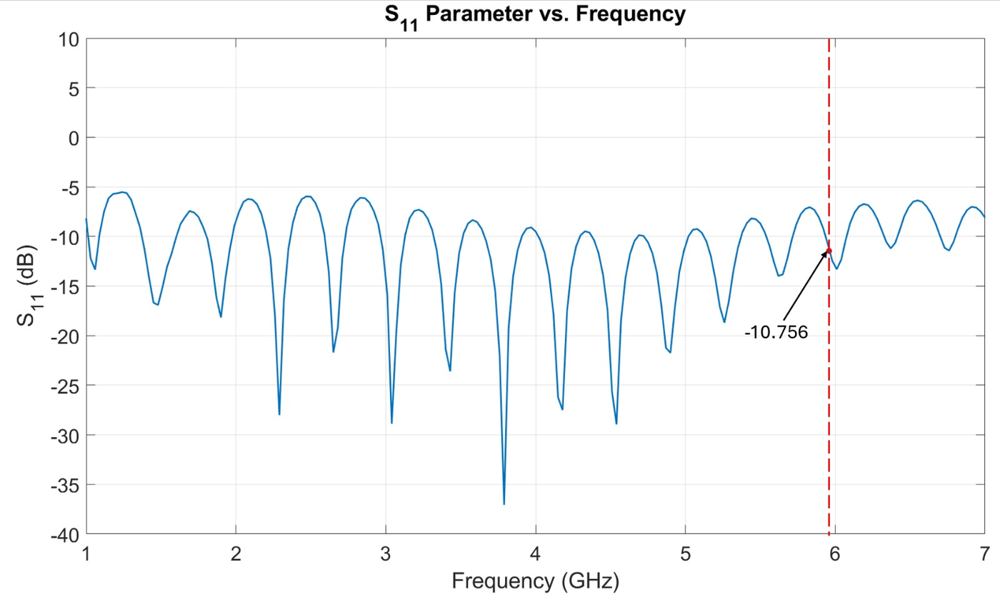
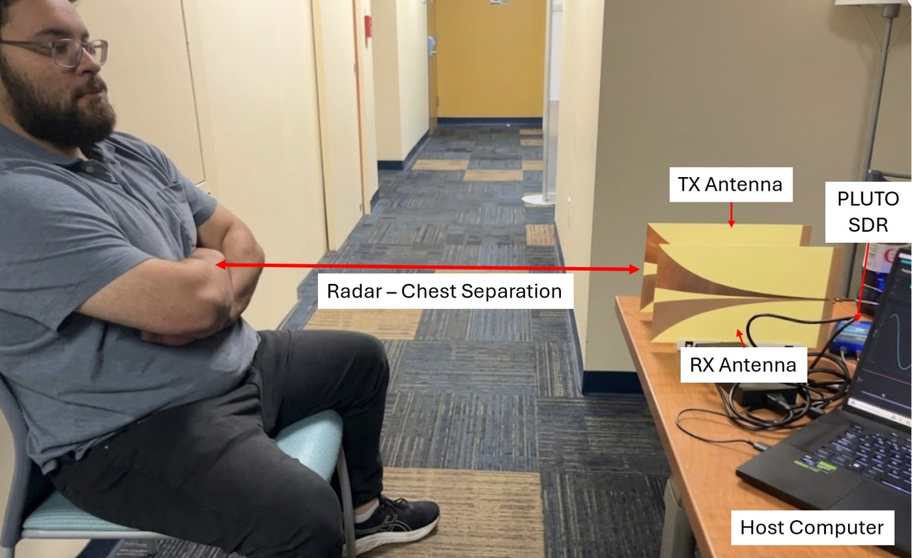
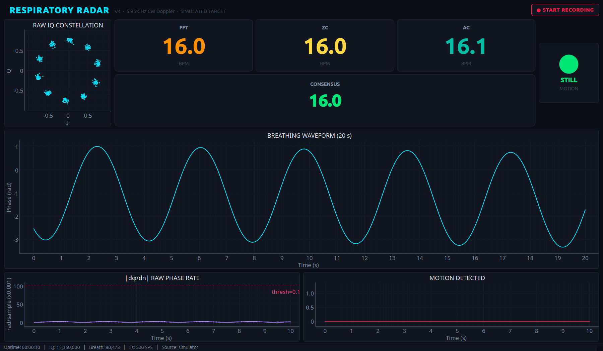

# CW Doppler Respiratory Radar

[](https://github.com/fede-is-rico/cw-doppler-respiratory-radar/actions/workflows/tests.yml)

A 5.95 GHz continuous-wave Doppler radar that measures breathing rate without
contact, built on an ADALM-Pluto SDR and GNU Radio. Chest-wall motion of a few
millimetres shows up as a few radians of carrier phase; the signal chain
extracts that phase, three independent estimators turn it into breaths per
minute, a vote combines them, and a separate motion path flags gross body
movement so bad readings are not trusted.



Course project for EEE 4550/5557 Radar Systems at Florida International
University (Spring 2026, Group 04), cleaned up and extended with a simulator,
tests, and fixes after the course. The final report is in
[`docs/`](docs/RADAR_Final_Project_Spring_2026_Group04_Report.pdf) and the
design is written up in [`docs/DESIGN_NOTES.md`](docs/DESIGN_NOTES.md).

## How it works



| | |
|---|---|
| Carrier | 5.95 GHz (λ = 50.4 mm) |
| Phase sensitivity | 4.01 mm of chest displacement per radian (two-way path) |
| Transmit | 100 kHz tone at baseband, so the echo sits away from the Pluto's DC offset |
| Receive | 1 MS/s, shifted and decimated 2000:1 to 500 S/s |
| Breathing band | 0.1–0.5 Hz (6–30 BPM) |
| Antennas | Two custom Vivaldi elements (1–7 GHz), S11 = −10.8 dB at 5.95 GHz |

The receiver sees the transmitted tone plus its reflections. After shifting the
tone to DC and low-pass filtering, the stationary reflections form a constant
phasor and the chest forms a phasor that rotates back and forth with each
breath. A DC blocker removes the stationary part, `complex_to_arg` takes the
angle, a streaming unwrap removes the ±π jumps, and the result is the
breathing waveform in radians.

Three estimators read that waveform in parallel, each with a different failure
mode:

- **FFT**: 15 s window, Hann, linear detrend, parabolic peak interpolation,
  accepted only if the peak clearly beats the in-band noise floor.
- **Zero crossing**: Schmitt trigger whose thresholds track the signal's
  peak-to-peak, so it re-scales itself to the subject. Fastest to respond.
- **Autocorrelation**: 60 s window, period found as the first autocorrelation
  peak between 2 s and 20 s. Slowest, but immune to offset and drift.

The dashboard shows all three and a consensus: the closest pair within 3 BPM
sets the value, and the label says whether 3/3 or only a pair agree.

A second path takes the phase *without* the DC blocker, differentiates it, and
trips a motion detector when the phase rate exceeds 0.1 rad/sample (about
200 mm/s of radial velocity) for 100 ms. Breathing never gets near that;
shifting in a chair does. The LED tells the operator when to disregard the
rate.



## Hardware

| | |
|---|---|
|  |  |
| Custom Vivaldi antenna, one of two | S11 at the 5.95 GHz operating point |



ADALM-Pluto (AD9363) with its tuning range extended to 6 GHz by the AD9364
firmware setting (exact commands in the design notes, section 2.1), TX
attenuation 0 dB, RX gain 50 dB manual, 20 MHz RF
bandwidth, separate TX and RX Vivaldi antennas, subject at 0.5–2 m. Two
HackRF Ones (independent LOs drift faster than breathing) and a BladeRF
(USB underflows under WSL2) were tried first and rejected, and the first
antenna pair cost 15–20 dB through a bad SMA transition; the report and the
design notes tell that story.

## Running it

GNU Radio 3.10 with gr-iio is required and is not on PyPI; install it from
your distribution (`sudo apt install gnuradio` on Debian/Ubuntu) or
radioconda, then:

```bash
git clone https://github.com/fede-is-rico/cw-doppler-respiratory-radar
cd cw-doppler-respiratory-radar
python3 -m venv --system-site-packages .venv && source .venv/bin/activate
pip install -r requirements.txt

# No hardware: simulated breathing subject (add --sim-motion-period 30 for body movements)
python -m respradar.dashboard --sim --sim-bpm 16

# PlutoSDR over USB/Ethernet (default address 192.168.2.1)
python -m respradar.dashboard
python -m respradar.dashboard --uri ip:192.168.2.1
```



**Start recording** writes a CSV next to the program (`--log-dir` to change)
with one row per second plus every motion start/stop event:
`t_sec, event, fft_bpm, zc_bpm, ac_bpm, consensus_bpm, consensus_confidence, motion_state, notes`.

The plain GNU Radio Companion version with Qt sinks is
`grc/respiratory_radar_V4.grc`; open it in GRC 3.10 and run. Its embedded
Python blocks are copies of `respradar/blocks/`, kept in sync by
`tools/sync_grc_blocks.py` (and checked by the tests).

## Tests

```bash
python -m pytest -q      # 48 tests, about 15 s
```

Unit tests drive each block with synthetic breathing at 8–27 BPM, noise, and
awkward chunk sizes. An end-to-end test pushes 80 s of simulated 1 MS/s IQ
through the real flowgraph and checks that all three estimators lock and
that a simulated body movement trips the detector for exactly its duration
plus the hold time.

## What changed after the course

Writing the tests exposed problems the lab demo had hidden:

- **The FFT estimator rejected valid breathing.** On clean 20 BPM it output
  nothing, while 12, 15, 18, 22, 25 and 27 BPM passed. Its confidence gate
  compared the spectral peak with the median of all 0.1–0.5 Hz bins, but a
  Blackman-Harris window on a 15 s record has a main lobe ~0.53 Hz wide, so
  the "noise" median sat on the lobe itself. The block now uses a Hann window
  and a noise reference outside the main lobe; the peak/noise ratio for clean
  breathing went from 4–14 to 30–10,000 across the band.
- **A silent FFT crop.** The report's 20 s window is 10,000 samples; the
  8192-point `rfft` truncated it. The 15 s setting used in the demo had been
  avoiding the bug. The block now pads instead.
- **Estimator buffers assumed small chunks.** GNU Radio can hand a block more
  samples than its window in one call; the ring-buffer writes now cope.
- **The flowgraph would not compile under GNU Radio 3.10.12** (missing
  `window` import in the GRC namespace) and carried placeholder metadata.
- **Measured, not fixed:** the 2001-tap "0.1–0.5 Hz bandpass" at 500 S/s is
  really a 0.5 Hz low-pass (−1.4 dB at 0.1 Hz, −25 dB at 0.8 Hz); the DC
  blocker is what provides the high-pass side. And with only ~6 independent
  spectral samples in the breathing band, no in-band SNR gate can reliably
  reject pure noise. See the design notes for the numbers and what a proper
  presence detector would look like.

The code as it was at the end of the course is tagged `v4-as-delivered`.

## Repository layout

```
respradar/
  params.py         every tunable in one place (mirrors the .grc)
  flowgraph.py      the V4 signal chain; PlutoSDR or simulator front end
  sim_source.py     synthetic Pluto stream: breathing chest + drift + body movement
  blocks/           the GNU Radio embedded Python blocks, one per file
  taps.py           ring buffers between GNU Radio threads and the Qt timer
  consensus.py      the three-way vote
  session_logger.py CSV recorder
  dashboard.py      pyqtgraph dashboard and CLI
grc/                GNU Radio Companion flowgraph with the same blocks embedded
tools/              sync_grc_blocks.py
tests/
docs/               design notes, course report, figures
```

## Team

Group 04, EEE 4550/5557 Radar Systems, FIU, Spring 2026, taught by
Dr. Satheesh Bojja Venkatakrishnan: Federico Peon, Mathias Osiris,
Buddhipriya Gayanath, and Benn Roshnan Thevathasan. The radar, the signal
chain, the dashboard, and the report were a group effort; the report in
`docs/` is the team's own account of the project.

The post-course work in this repository (restructuring, simulator, tests,
estimator fixes, and these docs) was done by Federico Peon after the course.
The code was developed with Claude Code as a pair-programming assistant,
Claude Opus 4 during the course and Claude Fable 5.1 afterwards; each commit
names the model that helped write it.

The Vivaldi antennas were built by another FIU student in one of the
department's labs. The person in the test-setup photo is me, "Fede-is-rico".

## License

Code is MIT licensed (see `LICENSE`). The course report in `docs/` is
© 2026 its authors and is not covered by that license.
